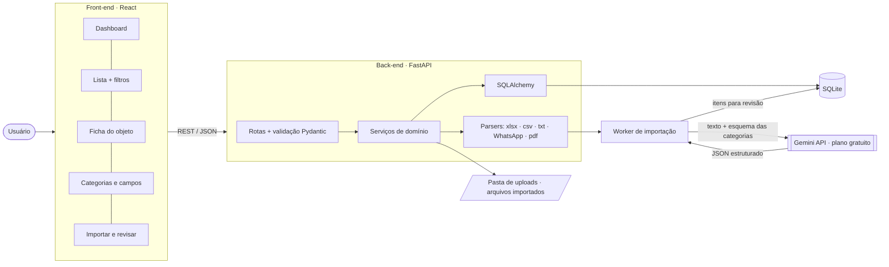
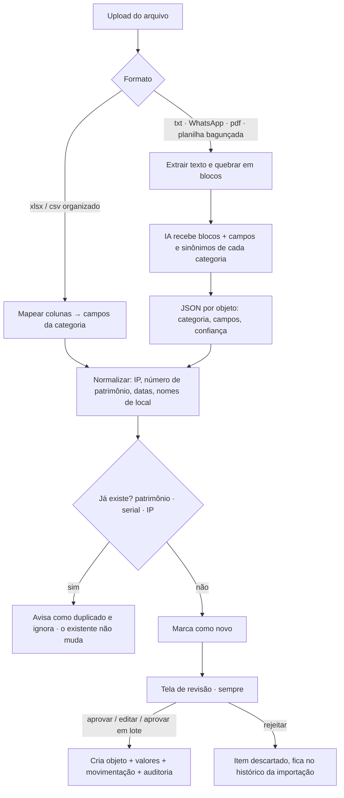
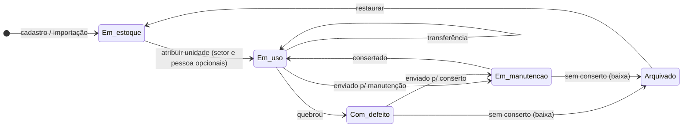
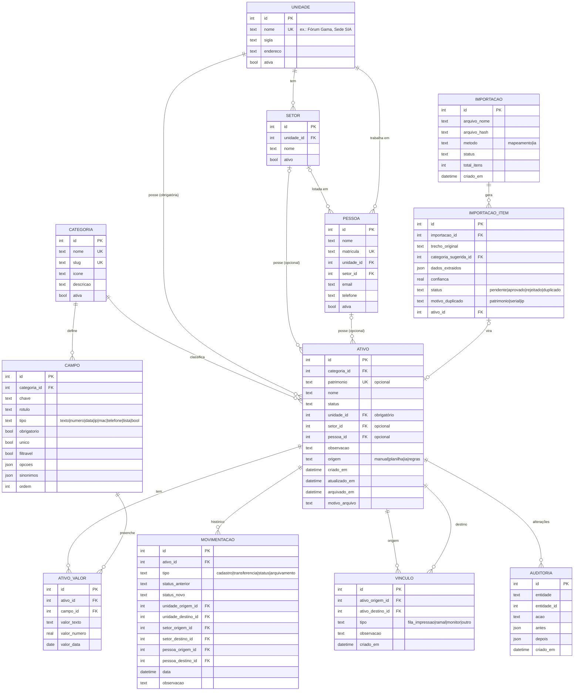

# Arquitetura — Sistema de Controle de Patrimônio

Painel para cadastrar, buscar e acompanhar equipamentos (impressoras, telefones, computadores…) com
**categorias de campos configuráveis**, posse por **unidade › setor › pessoa**, histórico de
movimentação, vínculos entre objetos, arquivamento de itens quebrados e **importação de planilhas e
textos soltos com IA (Gemini)**, sempre com revisão humana.

> Versão visual desta página: [`docs/arquitetura.html`](arquitetura.html) (abra no navegador).

## Stack

| Camada | Tecnologia |
|---|---|
| Front-end | React + Vite + TypeScript |
| Back-end | Python · FastAPI · SQLAlchemy · Pydantic |
| Banco | SQLite (modo WAL) |
| Importação | pandas/openpyxl (xlsx, csv), pdfplumber (pdf), texto puro (txt, WhatsApp) |
| IA | Google Gemini (plano gratuito) via `google-genai`, saída em JSON validada |
| Relatórios | PDF com ReportLab |
| Execução | Local, sem login (v1) |

## Visão geral



## Fluxo de importação com IA

A IA **nunca** grava direto no patrimônio: ela gera sugestões numa área de revisão. Uma pessoa aprova
(um a um ou em lote), edita ou rejeita. Objetos que já existem (mesmo patrimônio, serial ou IP) são
**marcados como duplicados e ignorados**; o cadastro existente não muda.



Exemplo real — mensagem de WhatsApp de uma visita técnica:

```text
DPDF – TJDFT SIG
Pat: 4386
Hostname: IMPSIGidos-4386
Endereço IP: 10.223.20.238 - IP Fixo
```

vira:

```json
{
  "categoria": "impressora",
  "patrimonio": "4386",
  "unidade": "TJDFT SIG",
  "campos": { "hostname": "IMPSIGidos-4386", "ip": "10.223.20.238" },
  "confianca": 0.97
}
```

Os **sinônimos** de cada campo (ex.: `ip` ← "Endereço IP", "IP") ensinam a IA e o mapeamento de
colunas a reconhecer o dado em arquivos diferentes.

## Ciclo de vida de um objeto

Status: `em_estoque` · `em_uso` · `em_manutencao` · `com_defeito` · `arquivado`.
Quebrou → "com defeito"; sem conserto → arquivado com motivo. Arquivado sai das listas padrão, mas
pode ser consultado e restaurado. Toda mudança de status ou de posse grava uma linha em `movimentacao`.



## Modelo de dados

O par `categoria → campo` define as características de cada tipo de objeto. Os valores ficam em
`ativo_valor`, uma linha por campo, com colunas tipadas (texto, número, data) para permitir filtros e
índices.



### Regras principais

| Tabela | Regra |
|---|---|
| `campo` | `UNIQUE(categoria_id, chave)`. Flags: obrigatório, único, filtrável. `sinonimos` (JSON) para IA/mapeamento |
| `ativo` | `patrimonio` opcional e único quando existe. `unidade_id` obrigatório; `setor_id` e `pessoa_id` opcionais (setor tem que ser da mesma unidade) |
| `ativo_valor` | `UNIQUE(ativo_id, campo_id)`; índice em `(campo_id, valor_texto)` |
| `setor` | `UNIQUE(unidade_id, nome)` |
| `movimentacao` | Só inserção, nunca editada. Guarda origem → destino de unidade/setor/pessoa e status anterior → novo |
| `vinculo` | Liga dois objetos (impressora ↔ fila, telefone ↔ ramal). `UNIQUE(origem, destino, tipo)` |
| `importacao_item` | `status`: pendente, aprovado, rejeitado, duplicado; `motivo_duplicado`: patrimonio, serial, ip |
| `auditoria` | Antes/depois em JSON de toda criação, edição e arquivamento |

Nada é apagado: objetos são arquivados, e a auditoria guarda cada alteração.

## Telas

| Tela | O que tem |
|---|---|
| Dashboard | Totais por categoria, status e unidade; com defeito; importações aguardando revisão; últimas movimentações |
| Objetos | Busca livre (patrimônio, nome, valores), filtros por categoria, status, unidade, setor, pessoa e campos filtráveis; exportar PDF |
| Ficha do objeto | Campos da categoria, posse, histórico, vínculos, auditoria; transferir, mudar status, vincular, arquivar |
| Categorias | Criar categoria e montar seus campos (tipo, obrigatório, único, filtrável, opções, sinônimos) |
| Importar | Upload (xlsx, csv, txt, WhatsApp, pdf), escolha entre mapeamento de colunas e IA, revisão lado a lado |
| Cadastros | Unidades e setores, pessoas, arquivados, configuração da chave do Gemini |

## Decisões da v1

| # | Pergunta | Decisão |
|---|---|---|
| 1 | Login | Sem login por enquanto |
| 2 | Onde roda | Local |
| 3 | Patrimônio | Opcional; único quando existe |
| 4 | Posse | Unidade obrigatória › setor opcional › pessoa opcional |
| 5 | Vínculo entre objetos | Sim, já na v1 |
| 6 | Quebrou | Passa por "com defeito"; arquiva com motivo quando não tem conserto |
| 7 | Manutenções e fotos | Não registra |
| 8 | Formatos | xlsx, csv, txt, WhatsApp, PDF |
| 9 | IA | Gemini, plano gratuito |
| 10 | Revisão | Sempre revisada, com aprovação em lote |
| 11 | Duplicado | Só avisa e ignora |
| 12 | Exportação | PDF |

> **Atenção (Gemini gratuito):** no plano gratuito o Google pode usar o conteúdo enviado para melhorar
> os produtos. Antes de enviar planilhas reais com IPs internos, confirme com a TI ou use o plano pago.
